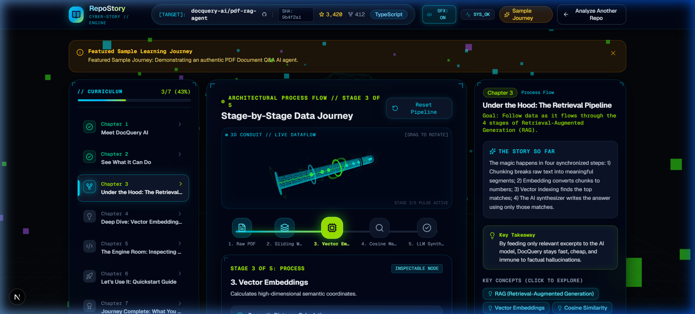
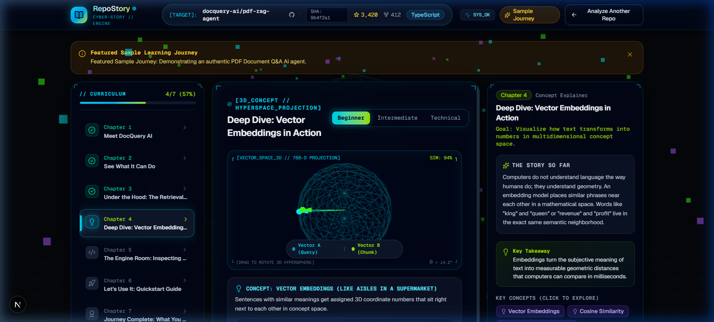
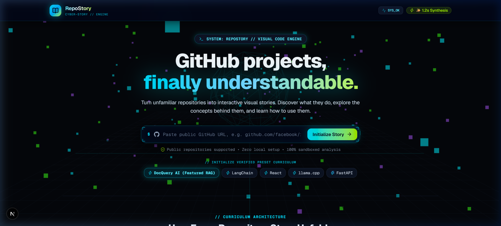
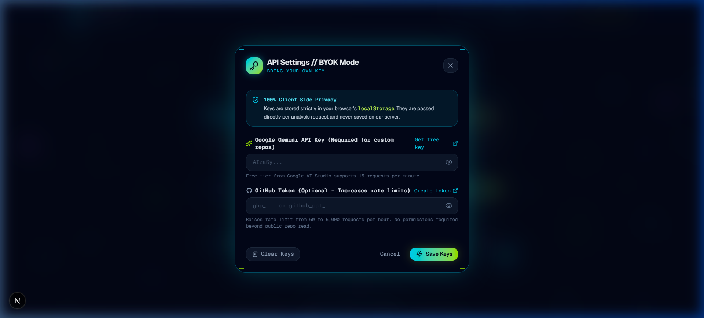
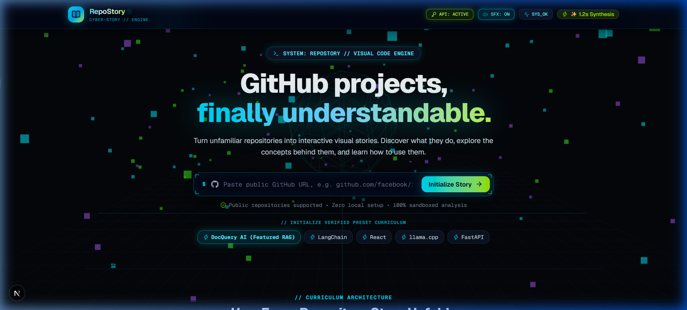
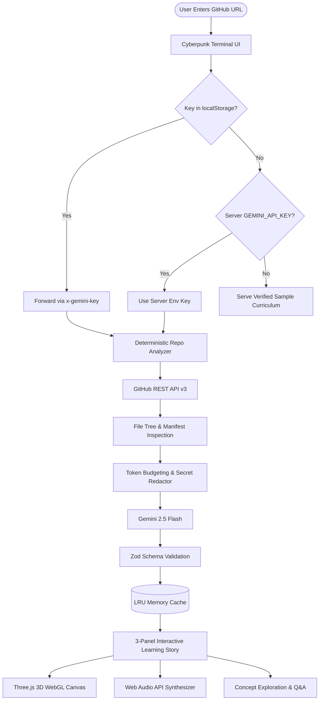
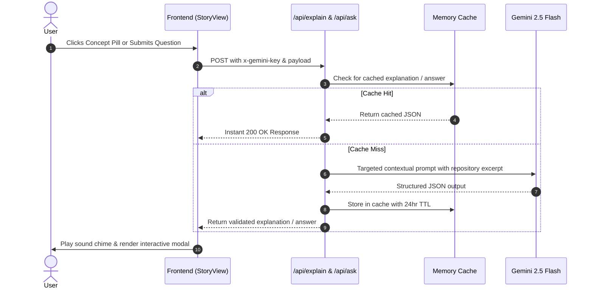

<div align="center">

# ⚡ RepoStory
### Turn Any GitHub Repository Into An Interactive 3D Learning Experience

> *"Paste a repository. Watch its architecture unfold in 3D. Understand what matters. Learn how to use it."*

[](https://repostorys.vercel.app/)
[](https://vercel.com/new/clone?repository-url=https://github.com/iamnih4l/RepoStory)
[](https://nextjs.org/)
[](https://react.dev/)
[](https://threejs.org/)
[](https://aistudio.google.com/)
[](https://tailwindcss.com/)
[](LICENSE)

<br />

[**🌐 Open Live App**](https://repostorys.vercel.app/) • [**📦 1-Click Deploy**](#-1-click-deploy-to-vercel) • [**🏗️ Architecture**](#%EF%B8%8F-system-architecture) • [**🔑 BYOK Guide**](#-zero-cost-hybrid-model--byok) • [**📡 Documentation**](#-api-specification)

</div>

---

## 📑 Table of Contents

- [💡 Why RepoStory?](#-why-repostory)
- [✨ Key Features](#-key-features)
- [🎬 Interactive Visual Showcase](#-interactive-visual-showcase)
- [📖 The 7-Chapter Curriculum](#-the-7-chapter-curriculum)
- [🔐 Zero-Cost Hybrid Model & BYOK](#-zero-cost-hybrid-model--byok)
- [🏗️ System Architecture](#%EF%B8%8F-system-architecture)
- [🚀 Quick Start & Installation](#-quick-start--installation)
- [📦 1-Click Deploy to Vercel](#-1-click-deploy-to-vercel)
- [📡 API Specification](#-api-specification)
- [🗺️ Roadmap & Features](#%EF%B8%8F-roadmap--features)
- [🛡️ Security & Privacy](#%EF%B8%8F-security--privacy)
- [📄 License & Author](#-license--author)

---

## 💡 Why RepoStory?

> [!TIP]
> 🚀 **Live Production Deployment:** Experience RepoStory immediately in your browser at **[repostorys.vercel.app](https://repostorys.vercel.app/)**!

Developers and learners discover remarkable open-source projects every day, yet struggle to understand or adopt them due to wall-of-text documentation, complex folder structures, and assumed prior domain knowledge.

RepoStory eliminates this barrier by acting as an **AI Product Architect, Technical Storyteller, and 3D Motion Designer**:

| Traditional GitHub Experience | The RepoStory Experience |
| :--- | :--- |
| 📄 2,000-line static Markdown READMEs | 🎮 Interactive 7-chapter picture-book curriculum |
| 📁 Cryptic nested directory hierarchies | 🌐 Interactive 3D data pipeline and dependency visualizers |
| 🧠 Abstract math & dense technical jargon | 💡 Multi-level explanations (**Beginner Analogies**, **Mechanisms**, **Deep Tech**) |
| 🧪 Guessing setup commands & config | 🚀 Verified installation guides with one-click copyable commands |
| 💸 Expensive generative image/video APIs | ⚡ Instant client-side **Three.js WebGL & Web Audio** ($0 render cost) |

---

## ✨ Key Features

### 1. 3D WebGL & Cyberpunk HUD Engine
- **Procedural Cyber-Grid**: Infinite reactive 3D wireframe plane with volumetric neon blocks and smooth cursor parallax.
- **3D Data Conduit (Chapter 3)**: Interactive cylindrical data conduit with glowing holographic rings and moving data packets — **drag with your mouse to orbit in 3D**.
- **3D Vector Hypersphere (Chapter 4)**: High-dimensional semantic sphere with real-time cosine angle calculation, query/chunk vector beams, and drag rotation.
- **Synthesized Cyber Audio**: Lightweight Web Audio API synthesizer for tactile interface feedback, chapter warps, stage shifts, and celebration chimes (with header toggle).
- **Glassmorphic Cyber HUD**: Frosted dark glass containers (`backdrop-blur-2xl`), cyan/lime perimeter glows, telemetry indicators (`SYS_OK`), commit SHA tags, and corner brackets (`[ ]`).

### 2. Deterministic Context Engine
- Scans repository tree, identifies dependencies, and pinpoints entry points using the GitHub REST API.
- Implements strict **Token Budgeting** (~20,000 characters, up to 12 selected files).
- Automatically sanitizes and redacts secrets, tokens, and credentials prior to prompt assembly.

### 3. Multi-Tiered Grounded Understanding
- **Interactive Inquiry Simulator**: Test sample queries and watch the multi-stage pipeline tokenize, retrieve, and synthesize responses in real time.
- **Verified Code Spotlight**: Real code extracted directly from repository files with highlighted lines and zero AI hallucination.
- **Contextual Grounded Q&A**: Ask any question and receive answers cited from verified source files.

---

## 🎬 Interactive Visual Showcase

<details open>
<summary><b>🖼️ Click to expand visual showcase screenshots</b></summary>
<br />

### 1. 3D Cylindrical Data Pipeline Conduit (Chapter 3)
*Inspect real-time data transformations with interactive Three.js 3D orbit controls.*


---

### 2. 3D Vector Hypersphere & Cosine Similarity (Chapter 4)
*Visualize high-dimensional embeddings with live coordinate vector beams and angular distance gauges.*


---

### 3. Cyberpunk Terminal Interface & Interactive Background
*Enter any public GitHub URL or test verified preset curricula.*


---

### 4. Client-Side Bring Your Own Key (BYOK) Modal
*100% client-side privacy: users supply their own free keys stored strictly in browser `localStorage`.*


---

### 5. Active Telemetry & Cyber HUD Header
*Telemetry indicator (`SYS_OK`), live synthesis timer, and active API status.*


</details>

---

## 📖 The 7-Chapter Curriculum

Every repository is transformed into a structured 7-chapter interactive learning story:

| Chapter | Scene Type | Learning Objective & Interactive Element |
| :---: | :--- | :--- |
| **1** | **The Big Picture** | Interactive step-by-step architecture flow with highlighted stage nodes. |
| **2** | **Capability Simulator** | Interactive inquiry testing station with real-time multi-stage pipeline execution. |
| **3** | **Architectural Process Flow** | **Interactive 3D Three.js Data Conduit** with drag-to-rotate inspection and pulsing stage rings. |
| **4** | **Concept Deep Dive** | **Interactive 3D Vector Hypersphere** comparing query and chunk vectors with cosine similarity gauges. |
| **5** | **The Engine Room** | Source code spotlight highlighting verified lines directly from repository files. |
| **6** | **Hands-On Setup** | 3-step quickstart with copyable shell commands, prerequisites, and `.env` configuration. |
| **7** | **Curriculum Mastery** | Milestone celebration with celebratory confetti, graduation badge, and concept summary. |

---

## 🔐 Zero-Cost Hybrid Model & BYOK

RepoStory is designed from the ground up to be **hosted publicly at $0 cost** without risk of depleted API credits:

```
┌─────────────────────────────────────────────────────────────┐
│                       REPOSTORY APP                         │
├──────────────────────────────┬──────────────────────────────┤
│       FEATURED DEMO          │         CUSTOM REPOS         │
│  (docquery-ai/pdf-rag-agent) │  (Any public GitHub project) │
├──────────────────────────────┼──────────────────────────────┤
│  ⚡ Zero-config instant play  │  🔑 BYOK Client-Side Modal   │
│  ⚡ Precomputed & cached      │  🔒 Stored in localStorage   │
│  ⚡ $0 API cost for host      │  ⚡ Zero cost for host       │
└──────────────────────────────┴──────────────────────────────┘
```

1. **Client-Side Privacy**: Keys entered into the **[API KEY]** modal are stored exclusively in the browser's `localStorage` (`apiKeyStorage.ts`).
2. **Per-Request Forwarding**: The frontend forwards keys via `x-gemini-key` and `x-github-token` headers directly per API call.
3. **Zero Server Liability**: Keys are never written to a server database, disk, or server logs.
4. **Free Tier Friendly**: Visitors can generate keys for free at [Google AI Studio](https://aistudio.google.com/app/apikey) (15 requests/min on Gemini 2.5 Flash).

---

## 🏗️ System Architecture



### Contextual Q&A & Concept Deep-Dive Sequence



---

## 🚀 Quick Start & Installation

### Prerequisites
- [Node.js](https://nodejs.org/) v18.18 or higher (Node 20+ recommended)
- [npm](https://www.npmjs.com/) or [pnpm](https://pnpm.io/)

### 1. Clone the Repository
```bash
git clone https://github.com/iamnih4l/RepoStory.git
cd RepoStory
```

### 2. Install Dependencies
```bash
npm install
```

### 3. Configure Environment Variables (Optional)
```bash
cp .env.example .env.local
```

Edit `.env.local`:
```env
# Optional: Server default Gemini API key (users can also BYOK in the UI)
GEMINI_API_KEY=your_gemini_api_key_here

# Recommended model
GEMINI_MODEL=gemini-2.5-flash

# Optional: GitHub token to increase rate limit from 60 to 5,000 req/hr
GITHUB_TOKEN=
```

> **Note**: If you omit `GEMINI_API_KEY`, RepoStory operates in **Featured Sample Mode** out of the box. You and your users can click the **[API KEY]** button in the header at any time to provide a key.

### 4. Run the Development Server
```bash
npm run dev
```

Open [http://localhost:3000](http://localhost:3000) (or the port specified in terminal) in your browser.

---

## 📦 1-Click Deploy to Vercel

The official production deployment is live at **[https://repostorys.vercel.app](https://repostorys.vercel.app)**.

You can also deploy your own independent instance of RepoStory to Vercel with a single click:

[](https://vercel.com/new/clone?repository-url=https://github.com/iamnih4l/RepoStory)

1. Click the **Deploy with Vercel** button above.
2. Link your GitHub account and specify a repository name.
3. *(Optional)* Set `GEMINI_API_KEY` in the environment variables, or leave it blank to let visitors use their own keys via BYOK.
4. Click **Deploy**. Your instance will be live worldwide in under 60 seconds!

---

## 📡 API Specification

| Endpoint | Method | Headers | Input Payload | Description |
|---|:---:|---|---|---|
| `/api/analyze` | `POST` | `x-gemini-key?`<br>`x-github-token?` | `{ repoUrl: string, level?: string }` | Analyzes repository AST, applies token budgeting, checks cache, and synthesizes 7-chapter curriculum. |
| `/api/explain` | `POST` | `x-gemini-key?` | `{ repoLessonId: string, conceptId: string, level?: string }` | Returns a deep dive across **beginner**, **intermediate**, or **technical** depth levels. |
| `/api/ask` | `POST` | `x-gemini-key?` | `{ repoLessonId: string, question: string }` | Answers contextual inquiries grounded directly in repository source code snippets. |
| `/api/health` | `GET` | — | — | Returns operational status, model configuration, rate-limit tier, and cache hit metrics. |

---

## 🧪 Verification & Testing

RepoStory includes an automated test suite:

```bash
# 1. Run core unit tests (URL parsing, token budgeting, secret redaction, Zod schemas)
npx tsx scripts/verify-engine.ts

# 2. Run live API endpoint integration tests
npx tsx scripts/test-api.ts

# 3. Verify production compilation & TypeScript checks
npm run build
```

---

## 🗺️ Roadmap & Features

- [x] Deterministic repository AST and manifest analysis
- [x] Single-request 7-chapter curriculum synthesis with Google Gemini 2.5 Flash
- [x] Multi-tier LRU in-memory cache keyed by `repo@commitSha:schemaVersion`
- [x] Three.js WebGL 3D interactive background with mouse parallax
- [x] Three.js WebGL 3D Data Conduit (Chapter 3) with drag-to-rotate controls
- [x] Three.js WebGL 3D Vector Hypersphere (Chapter 4) with real-time cosine angle gauges
- [x] Zero-dependency Web Audio API sound effects synthesizer with header toggle
- [x] Client-side Bring Your Own Key (BYOK) modal with `localStorage` isolation
- [x] One-click Vercel deployment configuration (`vercel.json`)
- [ ] Export curriculum as standalone interactive HTML / PDF slide deck
- [ ] Support for private repositories via GitHub OAuth App integration
- [ ] Interactive live in-browser terminal sandbox for verified CLI execution

---

## 🛡️ Security & Privacy

- **Zero Remote Code Execution (RCE)**: RepoStory statically parses files and manifests. It never installs dependencies or executes arbitrary code from analyzed repositories.
- **Client-Side Key Isolation**: BYOK keys never touch server databases or logs; they reside purely within browser `localStorage`.
- **Automated Secret Redaction**: All analyzed source code is sanitized using regex pattern matching to redact tokens, private keys, and passwords before being passed to the LLM.

---

## 📄 License & Author

This project is licensed under the **Apache-2.0 License** — see the [LICENSE](LICENSE) file for details.

Developed with craft by **[Nihal](https://github.com/iamnih4l)**.  
*Feedback, bug reports, and contributions are warmly welcome! Feel free to open an issue or submit a pull request.*
