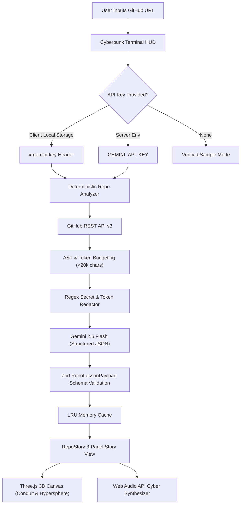

# RepoStory — Turn Any GitHub Repository Into an Interactive Learning Experience

[](https://vercel.com/new/clone?repository-url=https://github.com/iamnih4l/RepoStory)
[](https://nextjs.org/)
[](https://react.dev/)
[](https://threejs.org/)
[](https://aistudio.google.com/)
[](https://tailwindcss.com/)
[](LICENSE)

> *"Paste a repository. Watch its story unfold in 3D. Understand what matters. Learn how to use it."*

RepoStory transforms dense, intimidating GitHub repositories into interactive, animated, picture-book-style visual learning journeys. Designed for non-technical users, learners, and curious engineers to explore open-source codebases through **3D interactive WebGL scenes**, **hands-on inquiry simulations**, **modular concept deep-dives**, and **verified step-by-step setup guides**.

---

## 🌟 Key Features

### 1. 3D Cinematic Cyberpunk Interface
- **3D WebGL Background**: Procedural infinite cyber-grid plane, floating neon isometric blocks, rotating wireframe geometries, and subtle cursor parallax (`Three.js`).
- **Interactive 3D Data Conduit (Chapter 3)**: A glowing cylindrical cyber data pipeline in space with holographic stage rings and moving data packets — drag with your mouse to rotate in 3D.
- **Interactive 3D Vector Hypersphere (Chapter 4)**: High-dimensional semantic sphere with drag-to-rotate orbit controls, coordinate vector beams (Query A in cyan, Chunk B in lime), and real-time angular cosine similarity gauges.
- **Tactile Cyberpunk Audio (SFX)**: Zero-dependency Web Audio API synthesizer generating tactile interface clicks, stage switches, warp sweeps, and victory chimes (with header audio toggle).
- **Glassmorphic Cyberpunk HUD**: Frosted dark glass containers (`backdrop-blur-2xl`), cyan/lime perimeter glows, telemetry pills (`SYS_OK`), commit SHA tags, and corner HUD brackets (`[ ]`).

### 2. Hybrid Deployment Model (Host for $0 + Open Source)
- **Zero-Config Instant Start**: Includes an authentic, verified learning journey (`docquery-ai/pdf-rag-agent`) that works out of the box with zero setup.
- **Client-Side Bring Your Own Key (BYOK)**: Visitors on your hosted instance can plug in their own free Google Gemini API key via the **[API KEY]** settings modal. Keys are strictly stored in the browser's `localStorage` and sent directly per request — zero API bills for the host, zero keys saved on the server.
- **1-Click Self Hosting**: Deploy to Vercel, Railway, or run locally with a single command.

### 3. Deterministic Repository Analysis & Token Budgeting
- Parses public GitHub repositories using the GitHub REST API.
- Extracts READMEs, recursive file trees, and configuration manifests (`package.json`, `pyproject.toml`, `Cargo.toml`, etc.).
- Employs token budgeting (~20,000 characters, up to 12 selected files) and secret filtering to redact tokens and passwords prior to AI prompt assembly.
- Caches generated curricula in-memory using an LRU cache keyed by `repo@commitSha:schemaVersion`.

### 4. Interactive 3-Panel Picture-Book Layout
- **Left: Journey Navigator**: Displays chapters, completion checkmarks, and live progress percentage.
- **Center: Animated Learning Canvas**: Reusable animation engine rendering 7 scene types (`intro`, `capability-showcase`, `process-flow`, `concept-explainer`, `code-spotlight`, `getting-started`, `summary`).
- **Right: Plain-English Explanation Panel**: Narrative takeaways, clickable concept pills, verified source references with line numbers, and a grounded **Ask RepoStory** Q&A interface.

### 5. Interactive Concept Deep Dives & Grounded Q&A
- Click any concept (e.g. *Vector Embeddings*, *Cosine Similarity*, *Document Chunking*) to open a focused exploration modal.
- 3 explanation levels: **Beginner** (Everyday analogies), **Intermediate** (Computational mechanics), and **Technical** (Under the hood with math and SIMD architecture).
- Contextual Q&A grounded directly in repository source snippets with zero fabrication.

---

## 🏗️ System Architecture



---

## 🛠️ Tech Stack

- **Framework**: [Next.js 16](https://nextjs.org/) (App Router, Turbopack)
- **Language**: TypeScript
- **Styling**: Tailwind CSS & Vanilla CSS Design Tokens
- **3D & WebGL**: [Three.js](https://threejs.org/)
- **Animations & Motion**: Framer Motion, Canvas Confetti
- **Audio**: Web Audio API (Synthesizer, zero audio assets)
- **Validation**: Zod
- **AI Integration**: Official Google Gemini JavaScript SDK (`@google/genai` & `@google/generative-ai`)
- **API**: GitHub REST API v3

---

## 🚀 Quick Start (Run Locally)

### 1. Clone & Install Dependencies

```bash
git clone https://github.com/iamnih4l/RepoStory.git
cd RepoStory
npm install
```

### 2. Configure Environment (Optional)

Copy the example environment configuration:

```bash
cp .env.example .env.local
```

Edit `.env.local`:

```env
# Google Gemini API Key (Optional for local default; users can also BYOK via UI)
GEMINI_API_KEY=your_gemini_api_key_here

# Recommended model
GEMINI_MODEL=gemini-2.5-flash

# Optional: GitHub token to increase GitHub REST API rate limit from 60 to 5,000 req/hr
GITHUB_TOKEN=
```

> **Note**: If `GEMINI_API_KEY` is omitted, the application runs in **Featured Sample Mode**, and users can click the **[API KEY]** button in the header to enter their key anytime.

### 3. Run the Development Server

```bash
npm run dev
```

Open [http://localhost:3000](http://localhost:3000) (or the port shown in your terminal) in your browser.

---

## 🧪 Verification & Testing

RepoStory includes a complete verification suite:

```bash
# 1. Run core unit tests (URL parser, secret redactor, Zod schemas, cache)
npx tsx scripts/verify-engine.ts

# 2. Run live API endpoint integration tests
npx tsx scripts/test-api.ts

# 3. Run full production build and TypeScript check
npm run build
```

---

## 📡 API Specification

| Endpoint | Method | Headers / Payload | Description |
|---|---|---|---|
| `/api/analyze` | `POST` | `x-gemini-key?`, `x-github-token?`<br>`{ repoUrl: string, level?: string }` | Normalizes URL, fetches GitHub files, checks cache, generates structured story. |
| `/api/explain` | `POST` | `x-gemini-key?`<br>`{ repoLessonId: string, conceptId: string, level?: string }` | Generates a focused concept deep dive across 3 difficulty levels. |
| `/api/ask` | `POST` | `x-gemini-key?`<br>`{ repoLessonId: string, question: string }` | Answers contextual user questions grounded in repository source snippets. |
| `/api/health` | `GET` | — | Returns service status, Gemini model configuration, and cache statistics. |

---

## 🛡️ Security & Privacy

- **No Remote Code Execution**: RepoStory inspects repository source code statically. It never executes arbitrary code or installs third-party repository dependencies.
- **Client-Side BYOK Key Privacy**: Keys provided through the UI are stored exclusively in the user's browser `localStorage` and transmitted over TLS per request. They are never logged or stored on the server.
- **Secret Filtering**: Automatic regex redaction strips API keys, OAuth tokens, and passwords from source files prior to sending context to the language model.

---

## 📄 License

Apache-2.0
